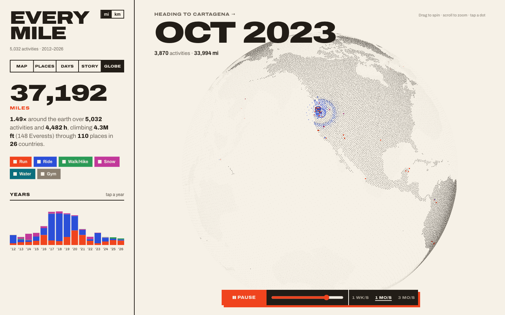
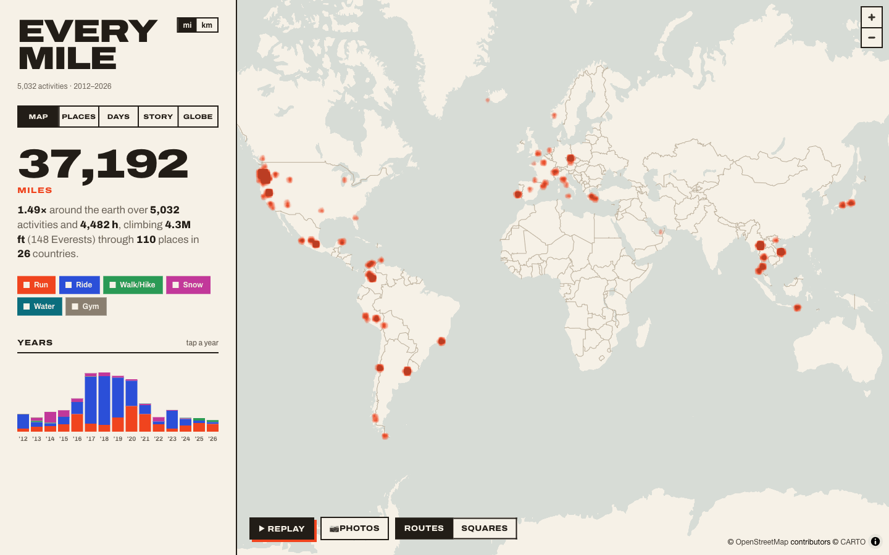
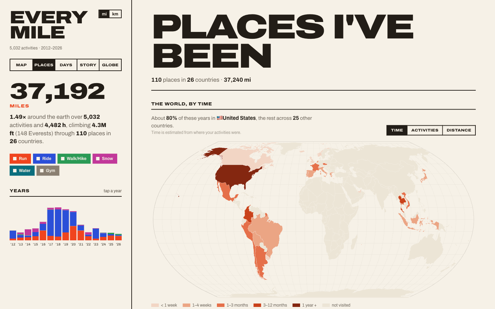
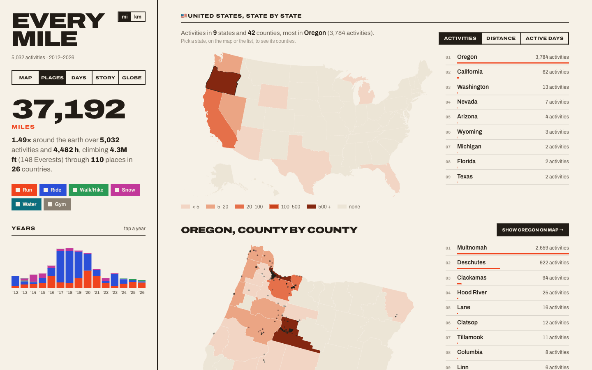

<h1 align="center">Every Mile</h1>

<p align="center">
  <b>Every activity you've ever recorded, on one map.</b><br />
  Bring your Garmin Connect history or a Strava export (or both) and get a map, a particle globe and a few posters of where you've been.
</p>

<p align="center">
  <a href="https://every-mile.surge.sh"><b>Live demo</b></a> ·
  <a href="#quick-start">Quick start</a> ·
  <a href="#getting-your-data">Getting your data</a> ·
  <a href="#sharing-it-online-optional">Sharing it</a>
</p>



**See a real one:** [every-mile.surge.sh](https://every-mile.surge.sh), about 3,600 activities from Garmin and Strava.

**Try it in a minute, no account needed:**

```sh
git clone https://github.com/seanburles/every-mile.git && cd every-mile
npm install
npm run demo      # a made-up athlete: marathons, famous climbs, surf trips, ski resorts → http://localhost:5173
```

Then hit **Use your own data** in the app to bring in your Garmin history or Strava export.

## What you get

<table>
  <tr>
    <td width="50%"></td>
    <td width="50%"></td>
  </tr>
  <tr>
    <td><b>Map</b>: every route, a heat map at world zoom, a card per activity (stats, elevation and heart rate), and a
      replay that flies through your history. Explorer squares too.</td>
    <td><b>Places</b>: countries shaded by time spent, activities or distance, plus a timeline of every stay and a poster
      of every city.</td>
  </tr>
  <tr>
    <td colspan="2"></td>
  </tr>
  <tr>
    <td colspan="2"><b>Up close</b>: your top country by state, then county by county with every start as a dot (for
      the US; other countries are broken down by place).</td>
  </tr>
</table>

The **Globe** (top) is a particle earth where your activities rain down in date order; during a replay the camera flies
to each new trip and the next activities wait until it arrives. Plus **Days** (a calendar grid per year, streaks, biggest weeks, "on this day") and **Story** (records and personal bests
over the years). Sport and year filters apply everywhere. Light and dark themes (it follows your system until you pick).

**Live cams** (optional): a camera badge near the places you've been, from Windy's free webcam directory. Click one to
watch today's time-lapse from that spot: Mt Hood from Government Camp, Wenceslas Square, Mont Blanc. See
[Live cams](#live-cams) to switch them on.

Everything runs on your own computer. Your data stays in this folder unless you choose to publish a copy.

## Quick start

You need [Node.js](https://nodejs.org) 20.12 or newer.

```sh
git clone https://github.com/seanburles/every-mile.git
cd every-mile
npm install
npm run demo
```

That opens the app at http://localhost:5173 with a demo athlete (based in Boulder, with trips to the Boston and Berlin
marathons, Alpe d'Huez and the Stelvio, Pipeline and Uluwatu, Whistler and Niseko, Kilimanjaro and more), so you can see
everything working.

**Use your own data** (the button in the panel) opens a setup wizard right in the page: add your name if you want it shown,
paste a Garmin key and/or drop in your Strava export, and watch it import. The demo athlete is swapped out once your
activities are in. Prefer the terminal? `npm run setup` does the same thing.

From then on, `npm run dev` starts the app. **Settings** (next to the activity count) changes your name or adds more data.

## Getting your data

### Garmin Connect (Personal API key)

1. Sign in to Garmin Connect and open **https://connect.garmin.com/app/settings/personalApiToken**
2. Create a key (valid 30 days to 1 year) and copy it
3. Paste it into the setup wizard (or `npm run setup`)

The key is saved to `.env` in this folder. `.env` is git-ignored and is never published. The first pull downloads a
GPS file for every activity, so a long history takes a while; it's safe to stop and run again, it resumes.

To pull new activities later: `npm run sync:routes`

### Strava export (no key needed)

1. Strava → Settings → My Account → **Download or Delete Your Account** → **Request your archive**
2. Strava emails you a link to a `.zip` (it can take a few hours). Download it.
3. Drop the `.zip` into the setup wizard (or run `npm run setup` and drag it into the terminal)

Or import directly: `npm run import -- ~/Downloads/export_12345678.zip`

Any folder of GPX / TCX / FIT files works too (old phone apps, other watches):
`npm run import -- ~/Documents/old-runs --source=phone`

### Both

Garmin goes first; the Strava export then fills in anything older and carries your Strava titles, descriptions and
photos over to the matching Garmin activities. Anything that starts within 5 minutes of a Garmin activity with a
similar distance counts as the same activity (Garmin wins). Strava's default names ("Morning Run") are ignored unless
you pass `--all-names`. Photos are resized and stripped of their metadata, including phone GPS.

## Sharing it online (optional)

`npm run publish` builds a static copy of the site and uploads it to a free host. [Surge](https://surge.sh) is the default
(the first run asks you to make an account). Tell it where:

```sh
npm run publish -- --domain=your-name-miles.surge.sh
```

or put `SURGE_DOMAIN=your-name-miles.surge.sh` in `.env` once and just run `npm run publish`.

**Anyone with the address can see it.** Before uploading, publish trims the start and end of every route within 500 m of
the places you start from most often (home, work: like Strava's privacy zones), and moves start dots to where the visible
route begins. Only the uploaded copy is changed.

**Ready to share.** Every build draws share images from your data: a link preview (the card that appears when you
paste your address into X, Facebook, iMessage, Slack or Reddit) and Instagram cards: a 4:5 feed post and 9:16 stories
for the overview, globe, places, days and records. Publish adds the preview tags with your address. The **Share** row at
the bottom of the panel posts the link to X, Facebook or Reddit, copies it, or opens the Instagram cards (on a phone,
tap one to send it to Instagram; on a computer it downloads). Redraw them on their own with `node scripts/og.mjs`.

| Flag | Does |
| --- | --- |
| `--no-photos` | leave imported photos off the shared copy (usually most of its size) |
| `--no-privacy` | publish exact routes (no privacy zones) |
| `--dry` | build into `dist/` without uploading (to host it yourself) |
| `--host=cloudflare --project=name` | upload to Cloudflare Pages instead, at `name.pages.dev` |

### How big is it, and what if the upload fails?

Publish prints the size before uploading, e.g. `site: 312 MB in 8,884 files (photos 190 MB)` for about 5,000 activities.
Photos are resized to web size first (1000 px, metadata stripped), but they're still most of it.

- **Surge** doesn't publish a size limit, but a big upload is slow and can drop partway on a shaky connection. Over
  500 MB, publish warns you and suggests a lighter copy.
- **Cloudflare Pages** (free) allows 20,000 files and 25 MiB per file. Publish checks both before uploading and tells
  you if your copy won't fit. Set it up once with `CLOUDFLARE_PROJECT=your-name-miles` in `.env` and
  `PUBLISH_HOST=cloudflare`; the first run asks you to sign in to a free Cloudflare account.
- **If an upload fails, nothing is lost.** The site is already built and complete in `dist/`. Run it again, try
  `--no-photos`, switch hosts with `--host=`, or host it yourself.

### Host it yourself

`dist/` is a plain folder of files: no server code, no database. Check it on your computer with `npm run preview`
(http://localhost:4173), then put it anywhere that serves static files:

- **Any web host or server**: copy the contents of `dist/` up (FTP, `rsync`, the host's file manager). It works at the
  root of a domain or in a subfolder like `example.com/miles/`.
- **Netlify** or **Cloudflare Pages** by drag and drop: drop the `dist/` folder onto their "deploy manually" page.
- **Your own machine**: `npx serve dist` or `python3 -m http.server --directory dist`.

The map's background tiles come from CARTO, so viewers need an internet connection. Everything else is in `dist/`.

## Commands

| Command | Does |
| --- | --- |
| `npm run demo` | generate the demo athlete and start the app |
| `npm run demo:remove` | take the demo athlete out again |
| `npm run setup` | terminal setup wizard: your name, Garmin key and/or Strava archive, then builds everything |
| `npm run dev` | the app at http://localhost:5173 (setup wizard under **Use your own data** / **Settings**) |
| `npm run sync:routes` | pull new Garmin activities and their GPS routes, then rebuild |
| `npm run sync` | pull Garmin activity summaries only (fast; no routes) |
| `npm run import -- <path>` | import a Strava archive or a folder of GPX/TCX/FIT files, then rebuild |
| `npm run build:data` | rebuild routes, places and stats from what's already downloaded (no network, apart from place names and live cams) |
| `npm run publish` | build a privacy-trimmed copy into `dist/` and upload it (Surge, or Cloudflare with `--host=cloudflare`) |
| `npm run preview` | open the built `dist/` copy at http://localhost:4173 |

Sync flags: `--full` re-pulls every activity, `--max=50` caps GPS downloads per run.
Import flags: `--dry` reports what would happen, `--all-names` also takes Strava's default names.

## Where things live

Nothing personal is committed: `.env`, `.cache/` and `public/data/` are all git-ignored.

- `.env`: your Garmin key (plus `SURGE_DOMAIN` if you publish, `WINDY_WEBCAMS_KEY` for live cams)
- `public/data/profile.json`: your name and whether to show it (it ships with a published copy, shown only if you said so)
- `.cache/fit/`: original FIT files from Garmin, so nothing is downloaded twice
- `.cache/imports/<source>/`: imported activities and tracks; re-importing a source replaces it
- `public/data/`: what the app loads (activities, routes, places, per-activity tracks, photos)

Place names come from OpenStreetMap's Nominatim (one lookup per city, cached in `.cache/geocode.json`;
`npm run build:data -- --no-geocode` skips it; `--no-webcams` skips the live-cam lookups).

---

## Reference

### Wrong sport?

Watches get left in "Run" on ski days. `build:data` flags runs/walks that ride chairlifts (sustained climbing >1 m/s, which no
runner manages, plus fast descents) during that hemisphere's ski season, and the app shows them as snow with a note.
The **Sport** dropdown on the activity card overrides anything while running `npm run dev`. Picks are saved to
`public/data/overrides.json` via a dev-only endpoint in `vite.config.js` (the Garmin API is read-only, so fixes stay local).

**Leave out of records** (on the same card) takes an activity out of Story's records and firsts without hiding it
anywhere else: the bus ride you forgot to stop, the altimeter that thinks you climbed Everest. Picks are saved to
`public/data/unranked.json`.

Records also skip impossible data on their own: bus rides logged as runs (speed check), lift-served climbing (snow days) and barometer
glitches (>200 m climb per km).

### Live cams

1. Get a free key at **https://api.windy.com/webcams** (sign up, then create a Webcams API key)
2. Add `WINDY_WEBCAMS_KEY=your-key` to `.env`
3. `npm run build:data` (or just `node scripts/webcams.mjs`)

Without a key there's simply no camera layer. The key is only used on your computer while building: the published page
plays Windy's public player, which needs none.

**How cameras are picked** (`scripts/webcams.mjs`, plain rules, no AI): for each place it asks Windy for cameras nearby
(25 km, 50 km for mountains), drops anything offline, stale, tagged traffic/indoor/airport or named like a road cam
("I-5 at Macadam", "US26 Ramp"), then scores the rest: popularity (log of views) + a bonus for scenic kinds (mountain,
coast and landscape highest, then city squares, then rivers and ports) − a little for distance. The top two per place win.
About half of places get one; busy cities and mountains do best.

**Don't like a pick?** Click the camera, then **Hide this camera** (while running `npm run dev`). It's saved to
`public/data/webcams-hidden.json` and the next build takes the runner-up. Windy's answers are cached in
`.cache/webcams.json` for 30 days. The free key has a request limit, so a first run over many places may stop partway;
it carries on from where it stopped the next time you build.

### How Garmin auth works

`.env` holds `GARMIN_PERSONAL_API_KEY`. The sync script POSTs it to
`/personalapitoken-service/personal-api/personal-api-key/token` with `Authorization: ApiKey <key>` and gets back a 24h JWT,
cached in `.cache/token.json`. Data calls use `Authorization: Bearer <jwt>` against `https://personal.connectapi.garmin.com`.
The API is read-only, pull-only, and only ever returns your own data.

### Garmin endpoints worth playing with

From Garmin's official client ([garmin/connect-personal-api-python](https://github.com/garmin/connect-personal-api-python)).

| What | Path | Range limit |
| --- | --- | --- |
| Activity search | `/activitylist-service/activities/search/activities?start&limit&startDate&endDate&activityType` | ≤50 per page |
| Activity detail | `/activity-service/activity/{id}` | |
| Original FIT (zip) | `/download-service/files/activity/{id}` (send `Accept: */*`, a zip-only Accept gets 406) | |
| Daily summaries | `/usersummary-service/v2/dailysummaries?startDate&endDate` | 180 days |
| Sleep | `/sleep-service/sleep/dailySleepSummariesByDate?startDate&endDate` | 28 days |
| HRV | `/hrv-service/hrv/daily/{start}/{end}` | 180 days |
| Body Battery | `/wellness-service/wellness/bodyBattery/reports/daily?startDate&endDate` | 28 days |
| Stress / steps | `/usersummary-service/stats/{stress,steps}/daily/{start}/{end}` | 7 days |
| Daily heart rate | `/wellness-service/wellness/dailyHeartRate?date` | 1 day |
| Fitness age | `/fitnessage-service/fitnessage/v2/{date}` | |
| HR zones | `/biometric-service/heartRateZones/v2` | |

Rate limits aren't published. Too large a range returns an empty 400.

### Data budget

- `routes.geojson`: every route simplified (Douglas–Peucker, ~9 m), ~11 MB for ~3.6k routes, loaded once
- `tracks/<id>.json`: ≤1000 points with time/distance/elevation/HR, ~28 KB, fetched only when you click
- `places.json`: 40 km clusters of activity starts, reverse-geocoded once
- The globe (three.js) and the US state/county shapes load only when you open those pages

### Code layout

- `scripts/setup.mjs`: terminal setup wizard; `src/wizard.js` + `vite.config.js`: the same in the page (dev server only)
- `scripts/demo.mjs`: the demo athlete, written as an import so it's removed cleanly
- `scripts/sync.mjs`: Garmin API → `public/data/activities.json`, FIT files → `.cache/fit/`
- `scripts/import.mjs`: Strava archive / GPX / TCX / FIT → `.cache/imports/`
- `scripts/build.mjs`: everything downloaded → routes, per-activity tracks, places, snow flags, explorer squares
- `scripts/publish.mjs`: build + privacy zones + preview tags + size check + upload (Surge or Cloudflare Pages)
- `scripts/webcams.mjs`: live cams near your places (Windy), picked by score
- `scripts/og.mjs`: share images (link preview + Instagram cards), SVG rendered with resvg; `src/share.js`: the Share row
- `src/main.js`: map, activity card, places poster, panel, tab routing
- `src/globe.js`: particle globe (three.js); `src/where.js` + `src/homeland.js`: Places maps;
  `src/replay.js`, `src/explorer.js`, `src/days.js`, `src/story.js`: one module per feature; `src/shared.js`: state + formatting
